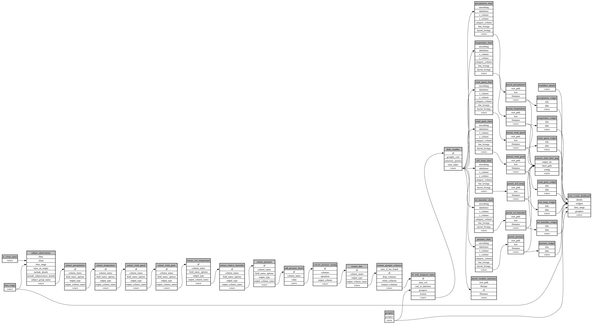

```
# AUTOGENERATED BY ECOSCOPE-WORKFLOWS; see fingerprint in README.md for details

```

```yaml
# fingerprint:
artifacts_sha256_basic: e0917c0c2d3a9a9fc9e42639ff53edaf9b1e1aae9fb7bef3efa2b60d22a5071f
artifacts_sha256_strict: 5a419a3f9dc998cf58fb0e90bd890b0be553d793f624423c1babf7ebc160ae2e
installed_requirements:
- channel: https://repo.prefix.dev/ecoscope-workflows/
  name: ecoscope-platform
  version: {version: ==2.15.1}
- channel: https://repo.prefix.dev/ecoscope-workflows-custom/
  name: ecoscope-workflows-ext-custom
  version: {version: ==0.1.0rc14}
- channel: https://repo.prefix.dev/ecoscope-workflows-custom/
  name: ecoscope-workflows-ext-mnc
  version: {version: ==1.0.6}
- channel: conda-forge
  name: pydeck
  version: {version: ==0.9.2}
params_sha256: 8c44a359c1c0b4e6d3d5c0d709ab08307c1ee4280eb18211b4b15e3cb5f5dcd7
spec_sha256: 732e5d199ed0d64cd27b046f6d3c2474584e2d55d661da088541a5f483d24806

```

# ecoscope-workflows-mnc-weather-report-workflow


